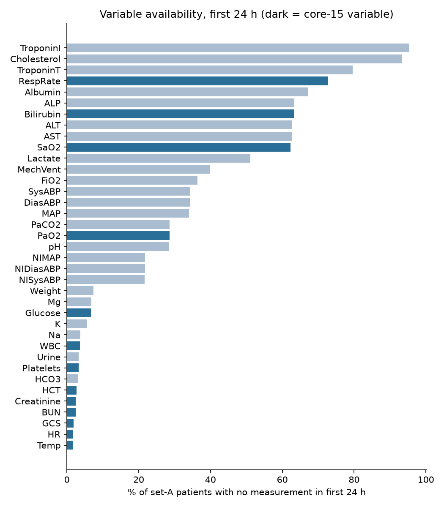
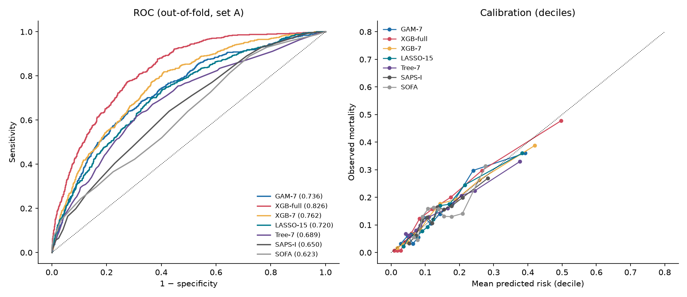
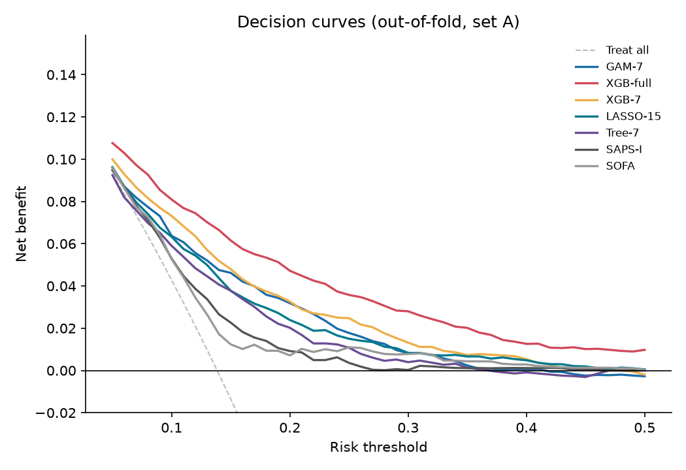
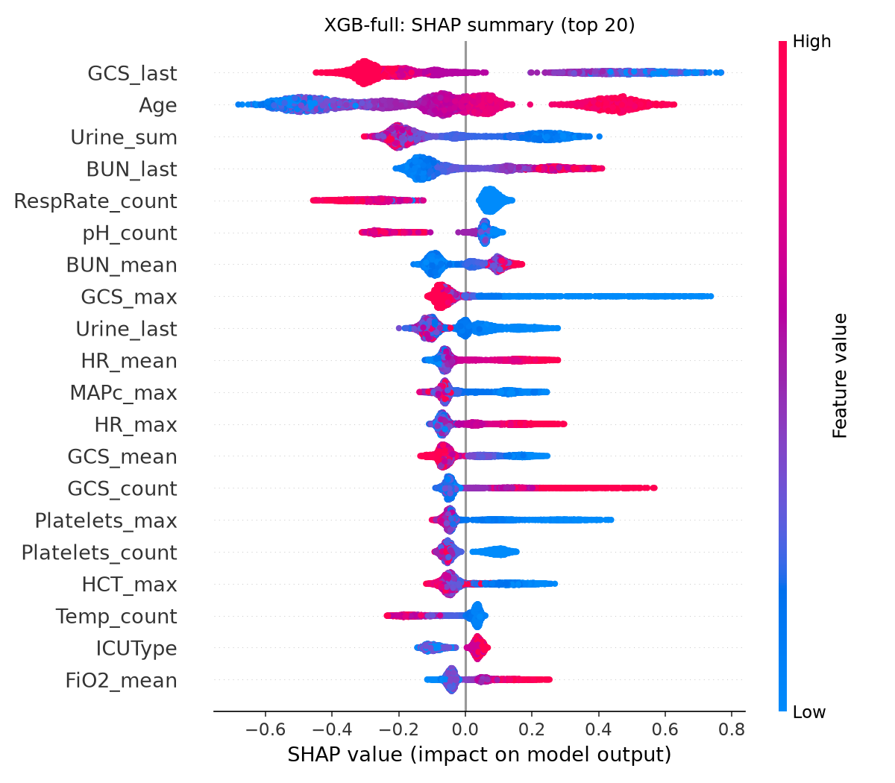
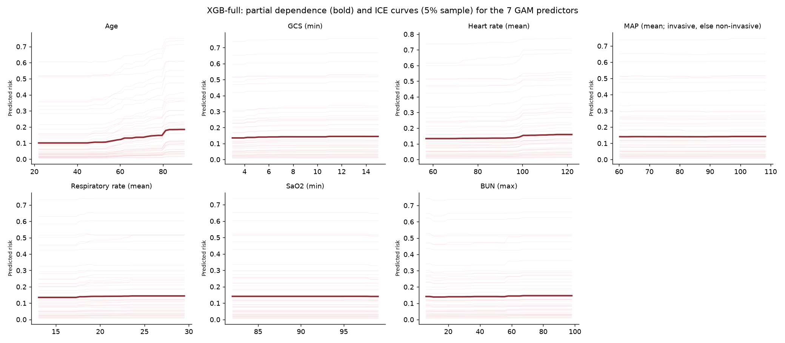

# A Simple, Interpretable Model versus a Black Box for Predicting In-Hospital Mortality in ICU Patients

**707 Final Project — Final Report**

**Team:** Junjie Cai, Yifei Chen, Jiahui Hu, Yuyao Lei

**Contents:** [Summary](#summary) · [Data](#data) · [Models and validation](#models) ·
[Results](#results) · [Interpretation](#interpretation) · [Limitations and conclusions](#conclusions) ·
[Reproducibility](#reproducibility) · [References](#references) · [AI statement](#ai-statement) ·
[Supplementary materials](#sec-supplement)

<a id="summary"></a>

# Summary

We compared a seven-predictor logistic generalized additive model (GAM-7) with
XGBoost using a broader first-24-hour feature set (XGB-full), with additional
interpretable models and clinical-score benchmarks. The outcome was in-hospital
death. Model development used nested cross-validation in set A; sets B and C
were held out from training and tuning.

Set A contained **4,000 records and 554 deaths (13.85%)**. The pooled out-of-fold AUROC was **0.736 for GAM-7** and **0.826 for XGB-full**. Their paired difference was 0.091 (conditional bootstrap 95% CI 0.072 to 0.110). Brier scores were 0.109 and 0.097, respectively.

The tested compact GAM sacrificed discrimination for a simpler additive
representation. This is a comparison of these fitted specifications, not proof
that every interpretable model must perform worse. No equivalence margin was
specified, so the study does not establish equivalence or noninferiority.
Post hoc explanations help describe XGBoost's predictions; neither these
explanations nor the decision curves establish clinical benefit or causal effects.

<a id="data"></a>

# Data, predictors, and quality checks

## Source and eligible cohort

We used PhysioNet/Computing in Cardiology Challenge 2012 v1.0.0, including
`set-a`, `set-b`, and `set-c` and their corresponding outcome files [1,2,3,5]. The unit of
analysis was an ICU stay record. The source cohort required an ICU stay of at
least 48 hours; therefore, this analysis does **not** represent all ICU admissions,
including those dying or discharged before that eligibility threshold [3]. Although
the source describes adult admissions, a few recorded ages are below 18; the
analysis retains the supplied cohort and treats this as a data-quality limitation.

**Table 1. Cohort characteristics and mortality by PhysioNet data set.**

| Set | Records | Deaths | Mortality (%) | Median age |
|:---|:---|:---|:---|:---|
| A | 4000 | 554 | 13.85 | 67.00 |
| B | 4000 | 568 | 14.20 | 67.00 |
| C | 4000 | 585 | 14.62 | 67.00 |

No record was excluded solely because predictors were missing. Outcome linkage
was checked one-to-one by RecordID, with binary outcome coding and matching
record counts. Sets B and C are **same-source held-out test sets**, not independent
geographic or prospective external validation cohorts.

## Feature construction

Predictors use measurements between 00:00 and 24:00 inclusive. Every raw record
file was checked to be in chronological order, so first/last summaries follow
the recorded time sequence. Negative sentinel values for static descriptors and
weight, and values outside the broad plausibility ranges listed in
`code/01_build_features.py`, are set to missing; FiO2 percentages are converted
to fractions. These screens do not guarantee removal of every erroneous measurement.

The small-7 features are age, minimum GCS, mean heart rate, mean combined MAP,
mean respiratory rate, minimum SaO2, and maximum BUN. Core-15 adds minimum PaO2,
maximum creatinine, maximum WBC, minimum platelets, minimum hematocrit, maximum
glucose, maximum bilirubin, and mean temperature. Combined MAP uses invasive
measurements when available, otherwise non-invasive measurements.

The seven-variable set follows the proposal (Section 3.2): age represents
demographics; GCS represents neurological status; heart rate and MAP represent
hemodynamics; respiratory rate and SaO2 represent respiratory status/oxygenation;
and BUN represents renal-related physiology [1,3]. This is a compact, domain-based
design choice, not the first seven variables selected by a statistical ranking.
The code performs no outcome-based selection of these seven variables. However,
the proposal provides no formal optimization of this subset or contemporaneous
selection audit beyond its stated rationale. We therefore do not claim it is
the optimal seven-variable set. High respiratory-variable missingness is an
important weakness of this choice.

The fifteen-variable set incorporated additional physiological and laboratory
measurements, including PaO₂ to further characterize respiratory status and
oxygenation; creatinine and bilirubin to assess renal and hepatic function;
WBC, platelets, and hematocrit to capture inflammatory and hematological
status; and glucose and temperature to reflect metabolic and physiological
conditions [1,3]. Together, these variables provided a broader range of clinical
information, allowing exploratory investigation of the potential benefits of
incorporating additional predictors through comparison with an intermediate
feature set.

The full set contains **193 input columns**: four static descriptors, mean/minimum/maximum/last/count for 37 time-series variables, three combined-MAP summaries, and total urine output. In set A, 4 of these columns are constant after median imputation (MechVent_mean, MechVent_min, MechVent_max, MechVent_last). Thus, 193 is an input-column count, not a count of independent informative predictors. RecordID, the all-record last timestamp, the overall observation count, and the unused first-value summaries are excluded from the model inputs.

The proposal established the main variable groups and some aggregation examples,
but did not document every final aggregation or sensitivity analysis. The
last/count summaries and the additional missingness/ventilation sensitivity are
reported as implementation choices, without claiming they were all fixed before
outcomes were examined. The proposal is submitted unchanged rather than
retrospectively rewritten to match the implementation.

## Missingness and residual artifacts

**Table 2. Missingness and distribution summaries for the 15 core predictors in set A.**

| Predictor | Missing (%) | Median | Q1 | Q3 |
|:---|:---|:---|:---|:---|
| Age | 0.0 | 67.0 | 52.8 | 78.0 |
| GCS (min) | 1.9 | 8.0 | 3.0 | 14.0 |
| Heart rate (mean) | 1.8 | 86.2 | 76.7 | 97.3 |
| MAP (mean; invasive, else non-invasive) | 1.8 | 77.9 | 71.7 | 86.2 |
| Respiratory rate (mean) | 72.6 | 19.0 | 16.7 | 22.0 |
| SaO2 (min) | 62.3 | 97.0 | 95.0 | 98.0 |
| BUN (max) | 2.5 | 20.0 | 14.0 | 32.0 |
| PaO2 (min) | 28.6 | 91.0 | 73.0 | 121.0 |
| Creatinine (max) | 2.5 | 1.0 | 0.7 | 1.5 |
| WBC (max) | 3.6 | 12.5 | 9.3 | 17.0 |
| Platelets (min) | 3.3 | 182.0 | 126.0 | 246.0 |
| Hematocrit (min) | 2.7 | 29.6 | 26.0 | 33.7 |
| Glucose (max) | 6.7 | 141.0 | 116.0 | 181.0 |
| Bilirubin (max) | 63.2 | 0.7 | 0.4 | 1.6 |
| Temperature (mean) | 1.8 | 36.9 | 36.5 | 37.4 |

Respiratory rate is missing for 72.6% of set A, including 2,405 of 2,405 records with documented ventilation. However, 498 records without documented ventilation also lack respiratory rate. Missing respiratory rate is therefore not equivalent to ventilation. A median-valued predictor may be an observed value or an imputed value; it cannot identify ventilation by itself.

A residual artifact audit flags 7 set-A records with mean invasive MAP above 200 mmHg while mean non-invasive MAP is between 40 and 120 mmHg. These are descriptive discordance flags, not validated exclusion rules. They remain in the primary analysis because the source does not identify which values should be corrected. Results may be sensitive to this choice; no robustness claim is made without an additional cleaning sensitivity analysis.



Missingness may encode treatment and measurement practices as well as patient
condition. The sensitivity labeled `GAM-7 + NA indicators` in result files adds
two missingness indicators **and a ventilation predictor** (10 inputs in total).
It is abbreviated GAM-7 + NA/vent here. Its performance change cannot be
attributed exclusively to missingness handling. Correlated physiological
variables and repeated summaries remain in the full feature set; they can share
or redistribute post hoc importance.

<a id="models"></a>

# Models and validation

## Model roles and figure selection

GAM-7, Tree-7, and XGB-7 use **exactly the same seven constructed predictors**.
LASSO-15, Ridge-15, and XGB-15 use **exactly the same core-15 predictors**.
XGB-full uses the full first-24-hour input set. The primary GAM-7 versus XGB-full
comparison intentionally changes both representation and model family; the
GAM-7 versus XGB-7 comparison holds the input set constant. There is no claim
that all models use 15 predictors.

**Table 3. Roles of the prespecified, supplementary, exploratory, and sensitivity models.**

| Role | Models | Purpose |
|:---|:---|:---|
| Primary | GAM-7, XGB-full | Main compact/additive versus broader boosted-model comparison |
| Clinical benchmarks | SAPS-I, SOFA | Supplied clinical scores |
| Supplementary | XGB-7 | Compare model families using the same seven inputs |
| Exploratory | Tree-7, LASSO-15, Ridge-15, XGB-15 | Simple alternatives, penalty comparison, intermediate feature set |
| Sensitivity | XGB-full native NA, GAM-7 + NA/vent | Alternative missing-value handling/additional indicators |

Ridge-15 assesses whether the core-15 logistic-regression results change with L2
rather than L1 regularization. XGB-15 provides an intermediate feature-set
comparison between XGB-7 and XGB-full. Neither is a separate primary hypothesis.

For readability, the main ROC, calibration, and decision-curve figures show
GAM-7, XGB-full, XGB-7, LASSO-15, Tree-7, and the two clinical benchmarks.
**Ridge-15, XGB-15, and the sensitivity models are omitted from those figures,
but included in the complete performance tables in [Appendix S1](#sec-supp-performance).** Thus, some exploratory
models are plotted and others are not; omission is not because XGBoost is a
black box. SHAP was computed for XGB-full and XGB-7, not XGB-15. XGB-15 was
evaluated in set-A cross-validation but was not refitted for B/C testing.

## Fitting and tuning

- GAM-7 uses penalized cubic splines, 10 basis functions per continuous
  predictor [6]. A common smoothing parameter is selected from 11 log-spaced values
  between 0.01 and 1,000 using inner-fold log-loss. A candidate whose fit raises
  an error receives a missing score and cannot be selected (scikit-learn default);
  convergence warnings were suppressed during fitting and were not logged.
- Tree-7 tunes maximum depth (2, 3, 4) and minimum leaf size (25, 50, 100).
- LASSO-15 and Ridge-15 use fold-internal standardization and tune inverse
  regularization strength C over 13 and 16 values, respectively.
- XGBoost uses histogram-based boosting and 25 randomly sampled configurations
  per inner search, spanning learning rate, number of trees, maximum depth,
  child weight, row/column sampling, L2 penalty, and split penalty. The maximum
  searched tree count is 600. Median imputation is primary; native missing-value
  handling is a separate sensitivity model [7].

Set A uses stratified five-fold outer cross-validation with the same outer
folds for every model (seed 707). Each outer training set has an inner stratified
five-fold search (seed 708). Imputation, scaling, and tuning occur only within
the relevant training folds [8]. After evaluation, selected models are tuned on all
of set A and refitted for interpretation and B/C prediction; these fitted
interpretation models are distinct from the outer-fold fits used for performance.

Selected configurations for each outer fold are reported in
[Appendix S4](#sec-supp-tuning).

All primary fitted models, including XGB-full, use training-fold **median
imputation**. For a shared predictor and identical training split, independently
fitted imputers therefore produce the same replacement value. LASSO and Ridge
add standardization after imputation. Native XGBoost missing-value routing is
restricted to the explicitly labeled sensitivity model. Consequently, native
versus median handling is not mixed into the primary model comparison, although
the broader feature set can still contain additional missingness information
through measurement counts.

## Clinical scores and metrics

SAPS-I and SOFA are taken from the supplied outcomes files, with negative values
treated as missing. Their **raw scores** are used consistently for AUROC,
including paired bootstrap comparisons [9,10]. For AUPRC (average precision), Brier
score, calibration, thresholds, and decision curves, scores are converted to
probabilities by logistic recalibration fitted only on outer training folds.
The supplied score windows were not independently reconstructed from raw
measurements; their temporal comparability to our first-24-hour predictors is
therefore uncertain.

Calibration-in-the-large is an intercept estimated with slope fixed at one;
calibration slope is estimated with a free intercept. Thresholds are the
corresponding outer training-fold mortality prevalence and 0.30. They are
illustrative evaluation thresholds, not validated treatment rules.

Paired percentile bootstrap intervals use 2,000 patient resamples of fixed
out-of-fold predictions, using the same eligible records for both models in
each comparison. They do not capture retraining, tuning, or fold-assignment
uncertainty. Exploratory comparisons are not adjusted for multiplicity.

<a id="results"></a>

# Results

## Main set-A performance

The main tables show the same five fitted models and two clinical benchmarks
as the main figures. [Appendix S1](#sec-supp-performance) reports all eleven
models, including Ridge-15, XGB-15, and both sensitivity analyses.

**Table 4. Main set-A out-of-fold predictive performance.**

| Model | N | AUROC | AP | Brier |
|:---|:---|:---|:---|:---|
| GAM-7 | 4000 | 0.736 | 0.301 | 0.109 |
| XGB-full | 4000 | 0.826 | 0.445 | 0.097 |
| XGB-7 | 4000 | 0.762 | 0.329 | 0.106 |
| Tree-7 | 4000 | 0.689 | 0.260 | 0.112 |
| LASSO-15 | 4000 | 0.720 | 0.304 | 0.110 |
| SAPS-I | 3810 | 0.650 | 0.229 | 0.115 |
| SOFA | 3856 | 0.623 | 0.261 | 0.117 |

Higher AUROC and AP indicate better discrimination/ranking; lower Brier indicates
better probability accuracy. Model values use all set-A records; each clinical
score uses its available-score subset. Cross-row differences involving clinical
scores should therefore be read from the **paired comparisons below**, not
calculated by subtracting unmatched full-cohort estimates.

**Table 5. Calibration and outer-fold AUROC variability for the main models.**

| Model | Cal. intercept | Cal. slope | Fold AUROC SD |
|:---|:---|:---|:---|
| GAM-7 | -0.001 | 0.975 | 0.012 |
| XGB-full | 0.096 | 1.002 | 0.010 |
| XGB-7 | 0.010 | 0.967 | 0.011 |
| Tree-7 | 0.020 | 0.788 | 0.021 |
| LASSO-15 | -0.017 | 0.980 | 0.014 |
| SAPS-I | 0.000 | 0.987 | 0.038 |
| SOFA | -0.000 | 0.998 | 0.012 |



## Paired performance differences

Selected primary, same-input, tree, and clinical-benchmark comparisons are shown
below. [Appendix S2](#sec-supp-paired) includes all exploratory and sensitivity
comparisons, with the same sign conventions and conditional-bootstrap limitations.

**Table 6. Selected paired AUROC differences with 95% bootstrap intervals.**

| First minus second | N | AUROC difference (95% CI) |
|:---|:---|:---|
| XGB-full minus GAM-7 | 4000 | 0.091 (0.072, 0.110) |
| XGB-7 minus GAM-7 | 4000 | 0.026 (0.014, 0.040) |
| XGB-full minus XGB-7 | 4000 | 0.064 (0.048, 0.082) |
| GAM-7 minus SAPS-I | 3810 | 0.086 (0.059, 0.115) |
| GAM-7 minus SOFA | 3856 | 0.114 (0.087, 0.140) |
| XGB-full minus SAPS-I | 3810 | 0.177 (0.154, 0.200) |
| XGB-full minus SOFA | 3856 | 0.204 (0.181, 0.228) |

**Table 7. Selected paired Brier-score differences with 95% bootstrap intervals.**

| First minus second | Brier difference (95% CI) |
|:---|:---|
| XGB-full minus GAM-7 | -0.0122 (-0.0156, -0.0091) |
| XGB-7 minus GAM-7 | -0.0027 (-0.0044, -0.0010) |
| XGB-full minus XGB-7 | -0.0094 (-0.0126, -0.0064) |
| GAM-7 minus SAPS-I | -0.0064 (-0.0091, -0.0037) |
| GAM-7 minus SOFA | -0.0062 (-0.0090, -0.0035) |
| XGB-full minus SAPS-I | -0.0184 (-0.0223, -0.0149) |
| XGB-full minus SOFA | -0.0188 (-0.0227, -0.0152) |

Positive AUROC differences favor the first model; negative Brier differences
favor the first model. Interval interpretation is conditional on the fitted
out-of-fold predictions and should not be treated as a fully refitted
cross-validation uncertainty analysis.

With seven inputs, XGB-7 achieved AUROC 0.762; XGB-15 achieved 0.786; and XGB-full achieved 0.826. These ordered feature-set comparisons suggest that the broader input representation was useful under the implemented tuning procedure. They do not isolate individual features, monitoring frequency, or interactions: feature content and fitted hyperparameters change together. The XGB-7 versus GAM-7 difference compares model specifications on the same inputs, not a pure estimate of interaction benefit. These AUROC differences must not be interpreted as a causal percentage decomposition.

Ridge-15 and LASSO-15 yielded AUROCs of 0.720 and 0.720. Their closeness is descriptive, not a formal equivalence result. The expanded GAM-7 + NA/vent sensitivity achieved 0.750; it includes information absent from GAM-7 and should not be called a pure imputation comparison.

## Threshold performance and decision curves

The main tables summarize the seven plotted models. Full confusion counts and
all four threshold metrics, including specificity and NPV, appear for all eleven
models in [Appendix S3](#sec-supp-thresholds).

**Table 8a. Threshold classification results for the main models (threshold: training-fold prevalence (~0.14)).**

| Model | TP | FP | FN | TN | Sensitivity | PPV |
|:---|:---|:---|:---|:---|:---|:---|
| GAM-7 | 367 | 1076 | 187 | 2370 | 0.662 | 0.254 |
| XGB-full | 402 | 848 | 152 | 2598 | 0.726 | 0.322 |
| XGB-7 | 381 | 1066 | 173 | 2380 | 0.688 | 0.263 |
| Tree-7 | 355 | 1182 | 199 | 2264 | 0.641 | 0.231 |
| LASSO-15 | 358 | 1120 | 196 | 2326 | 0.646 | 0.242 |
| SAPS-I | 317 | 1316 | 212 | 1965 | 0.599 | 0.194 |
| SOFA | 283 | 1330 | 261 | 1982 | 0.520 | 0.175 |

**Table 8b. Threshold classification results for the main models (threshold: 0.30).**

| Model | TP | FP | FN | TN | Sensitivity | PPV |
|:---|:---|:---|:---|:---|:---|:---|
| GAM-7 | 132 | 232 | 422 | 3214 | 0.238 | 0.363 |
| XGB-full | 223 | 259 | 331 | 3187 | 0.403 | 0.463 |
| XGB-7 | 162 | 255 | 392 | 3191 | 0.292 | 0.388 |
| Tree-7 | 122 | 248 | 432 | 3198 | 0.220 | 0.330 |
| LASSO-15 | 98 | 151 | 456 | 3295 | 0.177 | 0.394 |
| SAPS-I | 33 | 75 | 496 | 3206 | 0.062 | 0.306 |
| SOFA | 42 | 28 | 502 | 3284 | 0.077 | 0.600 |



Net benefit weights false positives by threshold odds, $t/(1-t)$. Within a panel,
all curves use the same records and prevalence. Panels should not be treated as
the same target population. The threshold range 0.05–0.50 is illustrative; no
specific intervention, treatment effect, or resource constraint was modeled.
Net-benefit differences represent weighted true-positive equivalents, not
observed additional lives saved.

## Same-source held-out sets B and C

**Table 9a. Same-source held-out predictive performance — set B.**

| Model | N | AUROC | AP | Brier |
|:---|:---|:---|:---|:---|
| GAM-7 | 4000 | 0.738 | 0.314 | 0.111 |
| XGB-full | 4000 | 0.848 | 0.468 | 0.095 |
| XGB-7 | 4000 | 0.753 | 0.331 | 0.109 |
| LASSO-15 | 4000 | 0.734 | 0.326 | 0.111 |
| Tree-7 | 4000 | 0.675 | 0.241 | 0.115 |
| SAPS-I | 3838 | 0.671 | Not evaluated | Not evaluated |
| SOFA | 3863 | 0.654 | Not evaluated | Not evaluated |
| Ridge-15 | 4000 | 0.734 | 0.324 | 0.111 |

**Table 9b. Same-source held-out predictive performance — set C.**

| Model | N | AUROC | AP | Brier |
|:---|:---|:---|:---|:---|
| GAM-7 | 4000 | 0.721 | 0.307 | 0.115 |
| XGB-full | 4000 | 0.837 | 0.464 | 0.099 |
| XGB-7 | 4000 | 0.734 | 0.320 | 0.114 |
| LASSO-15 | 4000 | 0.721 | 0.331 | 0.114 |
| Tree-7 | 4000 | 0.657 | 0.235 | 0.119 |
| SAPS-I | 3834 | 0.658 | Not evaluated | Not evaluated |
| SOFA | 3878 | 0.636 | Not evaluated | Not evaluated |
| Ridge-15 | 4000 | 0.721 | 0.331 | 0.114 |

Only raw-score AUROC was evaluated for the clinical benchmarks on B/C; missing
probability metrics are not zeros. XGB-15 and the two sensitivity models were
not included in this held-out evaluation. B/C were not used for tuning, and
higher held-out AUROC than cross-validated AUROC would not prove absence of
overfitting: population composition and sampling variation can also differ.

<a id="interpretation"></a>

# Interpretation

## Additive effects and model complexity

**Table 10. Model inputs and fitted complexity.**

| Model | Inputs | Fitted complexity |
|:---|:---|:---|
| Tree-7 | 7 | depth 3, 8 leaves = 8 if-then rules |
| GAM-7 | 7 | 7 smooth terms, effective df = 27.9 |
| LASSO-15 | 15 | 14 non-zero coefficients |
| Ridge-15 | 15 | 15 shrunken coefficients |
| XGB-7 | 7 | 600 trees × depth 2 (median over folds; ≤ 2,400 leaves) |
| XGB-15 | 15 | 600 trees × depth 4 (median over folds; ≤ 9,600 leaves) |
| XGB-full | 193 | 600 trees × depth 3 (median over folds; ≤ 4,800 leaves) |
| SAPS-I | 14 variables | Fixed additive point score |
| SOFA | 6 organ systems | Fixed additive point score |

Tree rules, additive smooths, and linear coefficients are directly inspectable
representations. They are not automatically clinically reliable. XGBoost requires
post hoc summaries; its interpretability is not equivalent to that of a small
decision tree or an additive model.


These curves describe fitted associations on the development data. GCS,
respiratory rate, and oxygen saturation may also reflect treatment or recording
practices. Sedation, surgical recovery, and clinical measurement decisions were
not separately measured or tested, so they cannot be established as mechanisms
from these plots. Last-value summaries describe recent observed state, not an
explicit trajectory or rate of recovery.

## Linear coefficients and tree rules

**Table 11. LASSO and Ridge coefficients and LASSO selection frequency.**

| Feature | LASSO / SD | Ridge / SD | LASSO folds / 5 |
|:---|:---|:---|:---|
| Age | 0.472 | 0.458 | 5 |
| BUN_max | 0.367 | 0.369 | 5 |
| HR_mean | 0.301 | 0.294 | 5 |
| Bilirubin_max | 0.264 | 0.262 | 5 |
| GCS_min | -0.228 | -0.230 | 5 |
| Glucose_max | 0.150 | 0.153 | 5 |
| HCT_min | 0.093 | 0.098 | 5 |
| PaO2_min | 0.092 | 0.098 | 5 |
| Temp_mean | -0.087 | -0.096 | 5 |
| SaO2_min | -0.086 | -0.090 | 5 |
| WBC_max | 0.071 | 0.078 | 5 |
| RespRate_mean | 0.053 | 0.063 | 5 |
| Creatinine_max | -0.029 | -0.037 | 3 |
| MAPc_mean | 0.000 | 0.009 | 2 |
| Platelets_min | 0.000 | -0.008 | 4 |

Coefficients are conditional log-odds changes per training-set standard deviation
after imputation and scaling. LASSO and Ridge impose linear effects; they do not
estimate U-shaped relationships unless those relationships are explicitly encoded.
Selection frequency is descriptive across the five outer training fits, not a
validated stability-selection probability.

```text
|--- BUN_max <= 27.50
|   |--- Age <= 79.50
|   |   |--- HR_mean <= 106.45
|   |   |   |--- weights: [1868.00, 120.00] class: 0
|   |   |--- HR_mean >  106.45
|   |   |   |--- weights: [242.00, 51.00] class: 0
|   |--- Age >  79.50
|   |   |--- GCS_min <= 11.50
|   |   |   |--- weights: [265.00, 69.00] class: 0
|   |   |--- GCS_min >  11.50
|   |   |   |--- weights: [152.00, 12.00] class: 0
|--- BUN_max >  27.50
|   |--- GCS_min <= 7.50
|   |   |--- HR_mean <= 98.01
|   |   |   |--- weights: [266.00, 101.00] class: 0
|   |   |--- HR_mean >  98.01
|   |   |   |--- weights: [78.00, 60.00] class: 0
|   |--- GCS_min >  7.50
|   |   |--- BUN_max <= 56.50
|   |   |   |--- weights: [407.00, 73.00] class: 0
|   |   |--- BUN_max >  56.50
|   |   |   |--- weights: [168.00, 68.00] class: 0

```

Tree thresholds apply after median imputation. Leaf values printed here are
training-sample class weights/counts, not held-out performance estimates.

## XGBoost and SHAP

TreeExplainer was used for XGB-full and XGB-7, with model-output contributions
on the log-odds scale [4,11]. Explanations are computed on the full set-A refits and are
descriptive in-sample analyses, not out-of-fold explanation validation. XGB-15
has performance estimates but **no SHAP analysis in this project**.



The highest-ranked full-model inputs by mean absolute SHAP are GCS_last, Age, Urine_sum, BUN_last, RespRate_count, pH_count. These rankings describe attribution under the fitted model and explanation method. Correlated summaries can share attribution; a high rank does not establish a causal effect or prove that removing the feature would reduce predictive performance.

**Table 12. Ten highest-ranked XGB-full predictors by mean absolute SHAP.**

| Feature | Mean absolute SHAP |
|:---|:---|
| GCS_last | 0.3043 |
| Age | 0.2793 |
| Urine_sum | 0.1931 |
| BUN_last | 0.1439 |
| RespRate_count | 0.1362 |
| pH_count | 0.1056 |
| BUN_mean | 0.0872 |
| GCS_max | 0.0858 |
| Urine_last | 0.0847 |
| HR_mean | 0.0829 |

Measurement counts can carry information about data availability and clinical
practice. An ablation study would be needed to attribute performance improvement
specifically to count features, last values, or any other feature family.



Partial dependence replaces one input while leaving other inputs unchanged.
Because this feature set contains correlated summaries (for example minimum,
maximum, mean, and last values of the same variable), this can create unrealistic
combinations. These curves are model summaries, not simulated clinical interventions.

## XGB-7 interactions

**Table 13. Leading pairwise SHAP interactions for XGB-7.**

| Feature 1 | Feature 2 | Mean absolute pair contribution |
|:---|:---|:---|
| MAPc_mean | BUN_max | 0.1188 |
| GCS_min | MAPc_mean | 0.1060 |
| Age | BUN_max | 0.0887 |
| Age | MAPc_mean | 0.0795 |
| Age | GCS_min | 0.0743 |
| HR_mean | BUN_max | 0.0502 |
| RespRate_mean | BUN_max | 0.0393 |
| GCS_min | BUN_max | 0.0353 |
| Age | HR_mean | 0.0313 |
| MAPc_mean | RespRate_mean | 0.0278 |

The pair statistic is twice the mean absolute off-diagonal SHAP interaction
value, counting both symmetric entries. It is an attribution-magnitude summary,
not a percentage of model performance. Absolute main-effect and total-SHAP
magnitudes cannot be divided into a valid percentage of signal explained:
signed contributions can cancel, and absolute values are not additive. The
project therefore makes no claim that an additive model captures a particular
percentage of the full signal.

<a id="conclusions"></a>

# Limitations and conclusions

The comparison is limited by a single retrospective data source, a cohort
selected to have ICU stays of at least 48 hours, substantial missingness,
residual measurement artifacts, and uncertainty about supplied clinical-score
windows. No alternate MAP-cleaning analysis or feature-family ablation was
performed. Native missing-value handling and added indicators address only
part of these issues.

The tuning search is finite. Selecting the maximum searched number of trees
indicates a search boundary, not evidence that increasing it must improve
performance or strengthen the conclusion. Other compact model specifications,
feature selections, and tuning ranges could give different comparisons.
Bootstrap intervals condition on existing predictions; repeated nested
cross-validation or full refitting would be needed to assess additional
training variability. Multiple exploratory comparisons and in-sample
explanation plots should be interpreted accordingly.

Within the tested specifications, XGB-full offers better discrimination and
probability accuracy than GAM-7, while GAM-7 offers a simpler additive
representation. The seven-input and core-15 XGBoost comparisons provide
context for this trade-off, without identifying a causal source of the gain.
Neither predictive performance nor post hoc interpretability establishes that
a model is ready for clinical deployment.

<a id="reproducibility"></a>

# Reproducibility and project organization

The analysis is a sequence of numbered Python scripts in `code/`, run in the
order 01 → 02 → 03 → 05 by `run_all.sh`:

| Script | Purpose |
|:---|:---|
| `01_build_features.py` | Parse raw records and build first-24-hour features for sets A, B, and C |
| `02_data_quality.py` | Cohort summary, missingness, distributions, redundancy |
| `03_models.py` | Nested cross-validation, paired bootstrap, B/C evaluation, SHAP/PDP |
| `05_supplement.py` | Ridge-15, model-complexity summary |
| `featuresets.py` | Shared definitions of the small-7, core-15, and full feature sets |

The Python environment is specified in `environment.yml` (conda environment
`icu707`). With the PhysioNet files in `data/` (see `README.md`):

- `bash run_all.sh`: extract data, build features, fit and evaluate all models,
  and write every table and figure to `results/`.
- `python code/07_final_report.py`: generate this report (`Final_Report.md`,
  and a self-contained `Final_Report.html` when the `markdown` package is
  installed) from `results/`. It only reads saved results; it does not refit models.
- `python code/07_final_report.py --with-code`: additionally append the
  analysis source code as an appendix.

`run_all.sh` runs the report step automatically at the end. All paths are
relative to the project root. `code/04_report.py` and
`code/06_report_zh.py` produce quick-look HTML summaries and are not part of
this report.

**Recorded modeling versions:** xgboost 3.4.2; pygam 0.12.0; shap 0.51.0; sklearn 1.9.1.

<a id="references"></a>

# References

1. Silva I, Moody G, Scott DJ, Celi LA, Mark RG. Predicting in-hospital mortality
   of ICU patients: the PhysioNet/Computing in Cardiology Challenge 2012.
   *Computing in Cardiology*. 2012;39:245–248.
2. Goldberger AL, et al. PhysioBank, PhysioToolkit, and PhysioNet: components of
   a new research resource for complex physiologic signals. *Circulation*.
   2000;101(23):e215–e220.
3. PhysioNet. [Predicting Mortality of ICU Patients: PhysioNet/Computing in
   Cardiology Challenge 2012, version 1.0.0](https://physionet.org/content/challenge-2012/1.0.0/).
   Data distributed under the Open Data Commons Attribution License v1.0.
4. SHAP documentation. [TreeExplainer](https://shap.readthedocs.io/en/latest/generated/shap.TreeExplainer.html).
   Consulted for SHAP and interaction-value interpretation.
5. Pollard T, et al. PhysioNet as a global platform for biomedical research.
   *Nature Health*. 2026;1:792–795.
   [doi:10.1038/s44360-026-00096-z](https://doi.org/10.1038/s44360-026-00096-z).
   Current standard PhysioNet citation requested by the dataset page.
6. Hastie T, Tibshirani R. Generalized additive models. *Statistical Science*. 1986;1(3):297–310.
7. Chen T, Guestrin C. XGBoost: a scalable tree boosting system. In: *Proceedings of the 22nd ACM SIGKDD International Conference on Knowledge Discovery and Data Mining*. 2016:785–794.
8. Varma S, Simon R. Bias in error estimation when using cross-validation for model selection. *BMC Bioinformatics*. 2006;7(1):91.
9. le Gall J-R, et al. A simplified acute physiology score for ICU patients. *Critical Care Medicine*. 1984;12:975–7.
10. Vincent JL, et al. The SOFA (Sepsis-related Organ Failure Assessment) score to describe organ dysfunction/failure. *Intensive Care Medicine*. 1996;22(7):707–10.
11. Lundberg SM, Lee S-I. A unified approach to interpreting model predictions. In: *Advances in Neural Information Processing Systems 30 (NeurIPS 2017)*. 2017:4765–4774.

<a id="ai-statement"></a>

# AI Statement

AI tools were used to support proposal organization, code development and debugging, and the preparation of the final report and presentation. Our team established the research question, study design, predictor sets, modeling approaches, validation strategy, and evaluation metrics. AI assistance was primarily used to refine the organization of the proposal, facilitate programming, improve the clarity of written materials, and synthesize key findings for presentation. The team was also responsible for defining the analytical objectives and workflow, reviewing the implementation, and interpreting the final results.

The use of AI offered several practical advantages. In particular, AI-assisted programming improved efficiency by helping identify potential sources of coding errors, suggesting alternative debugging strategies, and accelerating the development and refinement of analytical code. AI also facilitated the communication of complex results by helping condense the detailed report into a more focused presentation narrative. Nevertheless, the project also highlighted important limitations of AI assistance. AI-generated code and explanations were not always fully consistent with the intended analytical workflow and could contain errors or rely on assumptions that were inappropriate for the collaborative computational environment. In addition, AI could oversimplify methodological concepts, overlook important analytical details, or produce interpretations that were not fully supported by the numerical results.

Overall, AI tools helped reduce the time required for structural organization, programming and debugging, and scientific writing. This allowed our team to devote greater attention to evaluating analytical decisions, understanding the underlying statistical methods, and critically interpreting the results. The team retained responsibility for all methodological decisions, analyses, and conclusions presented in this report.


<a id="sec-supplement"></a>

# Supplementary Materials / Appendix

These materials are part of the report. Tables are generated from the same
result files as the main text; no additional models are fitted here. S1-S3
provide complete results, while S4 documents the selected tuning configurations.
The optional analysis-code listing follows these materials only when the report
is generated with `--with-code`.

<a id="sec-supp-performance"></a>

## S1. Complete model performance

**Table S1. Set-A out-of-fold performance for all models.** AUROC for SAPS-I and
SOFA uses raw scores; AP and Brier use fold-trained recalibrated probabilities.
Clinical-score sample sizes differ, so comparisons with these scores should use
the matched-record differences in S2. Lower Brier is better.

| Model | N | AUROC | AP | Brier |
|:---|:---|:---|:---|:---|
| GAM-7 | 4000 | 0.7355 | 0.3011 | 0.1089 |
| XGB-full | 4000 | 0.8260 | 0.4454 | 0.0968 |
| XGB-7 | 4000 | 0.7617 | 0.3287 | 0.1062 |
| Tree-7 | 4000 | 0.6886 | 0.2599 | 0.1124 |
| LASSO-15 | 4000 | 0.7203 | 0.3039 | 0.1098 |
| XGB-15 | 4000 | 0.7861 | 0.3816 | 0.1029 |
| XGB-full native NA | 4000 | 0.8266 | 0.4497 | 0.0965 |
| GAM-7 + NA/vent | 4000 | 0.7504 | 0.3170 | 0.1076 |
| SAPS-I | 3810 | 0.6498 | 0.2288 | 0.1154 |
| SOFA | 3856 | 0.6228 | 0.2613 | 0.1168 |
| Ridge-15 | 4000 | 0.7203 | 0.3041 | 0.1098 |

**Table S2. Calibration and variation across outer folds.** Calibration-in-the-large
fixes the slope at one; calibration slope is estimated with a free intercept.
Fold standard deviations describe variation, not confidence intervals.

| Model | Cal. intercept | Cal. slope | AUROC SD | Brier SD |
|:---|:---|:---|:---|:---|
| GAM-7 | -0.0007 | 0.9748 | 0.0121 | 0.0016 |
| XGB-full | 0.0957 | 1.0018 | 0.0102 | 0.0028 |
| XGB-7 | 0.0099 | 0.9666 | 0.0110 | 0.0014 |
| Tree-7 | 0.0199 | 0.7877 | 0.0213 | 0.0022 |
| LASSO-15 | -0.0165 | 0.9803 | 0.0142 | 0.0033 |
| XGB-15 | 0.0676 | 0.9729 | 0.0152 | 0.0016 |
| XGB-full native NA | 0.0958 | 0.9928 | 0.0095 | 0.0024 |
| GAM-7 + NA/vent | 0.0005 | 0.9606 | 0.0100 | 0.0021 |
| SAPS-I | 0.0004 | 0.9873 | 0.0380 | 0.0033 |
| SOFA | -0.0001 | 0.9979 | 0.0117 | 0.0019 |
| Ridge-15 | 0.0003 | 0.9834 | 0.0153 | 0.0034 |

The native-NA XGBoost sensitivity changes missing-value handling relative to
median-imputed XGB-full. The GAM-7 + NA/vent sensitivity adds two missingness
indicators and ventilation; it does not isolate imputation alone. Neither
sensitivity, nor XGB-15, was evaluated on B/C. Ridge-15 was evaluated on B/C.
SHAP coverage remains XGB-full and XGB-7 only.


<a id="sec-supp-paired"></a>

## S2. Complete paired comparisons

**Table S3. AUROC differences with conditional 95% bootstrap intervals.** Each
row uses the same records for both models and 2,000 jointly resampled record
sets. Positive differences favor the first model. These intervals condition on
existing out-of-fold predictions and do not incorporate refitting or retuning.
Exploratory intervals have not been adjusted for multiple comparisons.

| First minus second | N | Difference (95% CI) |
|:---|:---|:---|
| XGB-full minus GAM-7 | 4000 | 0.0905 (0.0718, 0.1099) |
| XGB-7 minus GAM-7 | 4000 | 0.0262 (0.0135, 0.0397) |
| XGB-15 minus GAM-7 | 4000 | 0.0506 (0.0350, 0.0667) |
| LASSO-15 minus GAM-7 | 4000 | -0.0152 (-0.0295, -0.0002) |
| Tree-7 minus GAM-7 | 4000 | -0.0469 (-0.0636, -0.0305) |
| XGB-full minus XGB-7 | 4000 | 0.0643 (0.0479, 0.0820) |
| XGB-full (native NA) minus XGB-full | 4000 | 0.0005 (-0.0038, 0.0052) |
| GAM-7 + NA indicators minus GAM-7 | 4000 | 0.0148 (0.0060, 0.0239) |
| GAM-7 minus SAPS-I | 3810 | 0.0861 (0.0592, 0.1147) |
| GAM-7 minus SOFA | 3856 | 0.1139 (0.0867, 0.1400) |
| XGB-full minus SAPS-I | 3810 | 0.1770 (0.1537, 0.2002) |
| XGB-full minus SOFA | 3856 | 0.2044 (0.1809, 0.2281) |
| Ridge-15 minus GAM-7 | 4000 | -0.0153 (-0.0310, 0.0005) |
| Ridge-15 minus LASSO-15 | 4000 | -0.0000 (-0.0019, 0.0019) |

**Table S4. Brier-score differences with conditional 95% bootstrap intervals.**
Negative differences favor the first model. The matched sample size for each
comparison is the same as in Table S3. Five decimal places preserve small
differences between the two regularized logistic models.

| First minus second | Difference (95% CI) |
|:---|:---|
| XGB-full minus GAM-7 | -0.01218 (-0.01557, -0.00914) |
| XGB-7 minus GAM-7 | -0.00274 (-0.00438, -0.00104) |
| XGB-15 minus GAM-7 | -0.00609 (-0.00848, -0.00367) |
| LASSO-15 minus GAM-7 | 0.00089 (-0.00126, 0.00308) |
| Tree-7 minus GAM-7 | 0.00341 (0.00148, 0.00534) |
| XGB-full minus XGB-7 | -0.00944 (-0.01263, -0.00639) |
| XGB-full (native NA) minus XGB-full | -0.00025 (-0.00112, 0.00061) |
| GAM-7 + NA indicators minus GAM-7 | -0.00139 (-0.00245, -0.00037) |
| GAM-7 minus SAPS-I | -0.00640 (-0.00910, -0.00369) |
| GAM-7 minus SOFA | -0.00620 (-0.00900, -0.00345) |
| XGB-full minus SAPS-I | -0.01838 (-0.02230, -0.01489) |
| XGB-full minus SOFA | -0.01878 (-0.02269, -0.01519) |
| Ridge-15 minus GAM-7 | 0.00088 (-0.00147, 0.00317) |
| Ridge-15 minus LASSO-15 | -0.00001 (-0.00019, 0.00018) |

<a id="sec-supp-thresholds"></a>

## S3. Complete threshold results

The prevalence threshold is calculated using each record's outer training fold,
not the held-out fold. The second threshold is fixed at 0.30. These are illustrative
cutoffs, not validated clinical intervention rules. Counts and probability metrics
use the available-score subset for each clinical benchmark.

**Table S5. All-model threshold performance: training-fold prevalence (~0.14).**

| Model | TP | FP | FN | TN |
|:---|:---|:---|:---|:---|
| GAM-7 | 367 | 1076 | 187 | 2370 |
| XGB-full | 402 | 848 | 152 | 2598 |
| XGB-7 | 381 | 1066 | 173 | 2380 |
| Tree-7 | 355 | 1182 | 199 | 2264 |
| LASSO-15 | 358 | 1120 | 196 | 2326 |
| XGB-15 | 382 | 924 | 172 | 2522 |
| XGB-full native NA | 406 | 838 | 148 | 2608 |
| GAM-7 + NA/vent | 389 | 1072 | 165 | 2374 |
| SAPS-I | 317 | 1316 | 212 | 1965 |
| SOFA | 283 | 1330 | 261 | 1982 |
| Ridge-15 | 353 | 1076 | 201 | 2370 |

**Table continued: sensitivity, specificity, positive predictive value (PPV), and negative predictive value (NPV).**

| Model | Sensitivity | Specificity | PPV | NPV |
|:---|:---|:---|:---|:---|
| GAM-7 | 0.6625 | 0.6878 | 0.2543 | 0.9269 |
| XGB-full | 0.7256 | 0.7539 | 0.3216 | 0.9447 |
| XGB-7 | 0.6877 | 0.6907 | 0.2633 | 0.9322 |
| Tree-7 | 0.6408 | 0.6570 | 0.2310 | 0.9192 |
| LASSO-15 | 0.6462 | 0.6750 | 0.2422 | 0.9223 |
| XGB-15 | 0.6895 | 0.7319 | 0.2925 | 0.9362 |
| XGB-full native NA | 0.7329 | 0.7568 | 0.3264 | 0.9463 |
| GAM-7 + NA/vent | 0.7022 | 0.6889 | 0.2663 | 0.9350 |
| SAPS-I | 0.5992 | 0.5989 | 0.1941 | 0.9026 |
| SOFA | 0.5202 | 0.5984 | 0.1754 | 0.8836 |
| Ridge-15 | 0.6372 | 0.6878 | 0.2470 | 0.9218 |

**Table S6. All-model threshold performance: 0.30.**

| Model | TP | FP | FN | TN |
|:---|:---|:---|:---|:---|
| GAM-7 | 132 | 232 | 422 | 3214 |
| XGB-full | 223 | 259 | 331 | 3187 |
| XGB-7 | 162 | 255 | 392 | 3191 |
| Tree-7 | 122 | 248 | 432 | 3198 |
| LASSO-15 | 98 | 151 | 456 | 3295 |
| XGB-15 | 188 | 279 | 366 | 3167 |
| XGB-full native NA | 228 | 255 | 326 | 3191 |
| GAM-7 + NA/vent | 145 | 232 | 409 | 3214 |
| SAPS-I | 33 | 75 | 496 | 3206 |
| SOFA | 42 | 28 | 502 | 3284 |
| Ridge-15 | 98 | 147 | 456 | 3299 |

**Table continued: sensitivity, specificity, positive predictive value (PPV), and negative predictive value (NPV).**

| Model | Sensitivity | Specificity | PPV | NPV |
|:---|:---|:---|:---|:---|
| GAM-7 | 0.2383 | 0.9327 | 0.3626 | 0.8839 |
| XGB-full | 0.4025 | 0.9248 | 0.4627 | 0.9059 |
| XGB-7 | 0.2924 | 0.9260 | 0.3885 | 0.8906 |
| Tree-7 | 0.2202 | 0.9280 | 0.3297 | 0.8810 |
| LASSO-15 | 0.1769 | 0.9562 | 0.3936 | 0.8784 |
| XGB-15 | 0.3394 | 0.9190 | 0.4026 | 0.8964 |
| XGB-full native NA | 0.4116 | 0.9260 | 0.4720 | 0.9073 |
| GAM-7 + NA/vent | 0.2617 | 0.9327 | 0.3846 | 0.8871 |
| SAPS-I | 0.0624 | 0.9771 | 0.3056 | 0.8660 |
| SOFA | 0.0772 | 0.9915 | 0.6000 | 0.8674 |
| Ridge-15 | 0.1769 | 0.9573 | 0.4000 | 0.8786 |

<a id="sec-supp-tuning"></a>

## S4. Tuning selections and numerical checks

The tables below list the configuration selected separately within each outer
training fold. Fold labels 1-5 correspond to stored fold indices 0-4. Selection
uses five-fold inner cross-validation and negative log-loss; all models share
the outer folds. These are **outer-fold selections**, not the parameters of the
separate full-set-A refits used for interpretation and B/C prediction.

The search ranges are described in the Methods. For XGBoost, the tables report
the chosen configuration among 25 sampled configurations, not an exhaustive
search of all parameter combinations.

**Table S7. Selected parameters for interpretable and regularized models.** C is inverse regularization strength; lam is the GAM smoothing penalty.

| Model | Parameter | Fold 1 | Fold 2 | Fold 3 | Fold 4 | Fold 5 |
|:---|:---|:---|:---|:---|:---|:---|
| GAM-7 | lam | 3.16228 | 3.16228 | 3.16228 | 3.16228 | 3.16228 |
| Tree-7 | max_depth | 4 | 3 | 4 | 4 | 4 |
| Tree-7 | min_samples_leaf | 100 | 100 | 100 | 100 | 100 |
| LASSO-15 | C | 0.215443 | 0.215443 | 0.215443 | 0.1 | 0.215443 |
| GAM-7 + NA/vent | lam | 1 | 3.16228 | 1 | 1 | 3.16228 |
| Ridge-15 | C | 0.0464159 | 0.0464159 | 0.0215443 | 0.0464159 | 0.0464159 |

**Table S8. Selected parameters: XGB-7.**

| Parameter | Fold 1 | Fold 2 | Fold 3 | Fold 4 | Fold 5 |
|:---|:---|:---|:---|:---|:---|
| subsample | 0.7 | 0.85 | 0.85 | 0.7 | 0.7 |
| reg_lambda | 10 | 5 | 5 | 1 | 1 |
| n_estimators | 600 | 200 | 200 | 600 | 600 |
| min_child_weight | 1 | 5 | 5 | 1 | 1 |
| max_depth | 4 | 2 | 2 | 2 | 2 |
| learning_rate | 0.02 | 0.1 | 0.1 | 0.02 | 0.02 |
| gamma | 0 | 0 | 0 | 0 | 0 |
| colsample_bytree | 0.5 | 1 | 1 | 1 | 1 |

**Table S9. Selected parameters: XGB-15.**

| Parameter | Fold 1 | Fold 2 | Fold 3 | Fold 4 | Fold 5 |
|:---|:---|:---|:---|:---|:---|
| subsample | 0.7 | 0.7 | 0.7 | 0.7 | 0.85 |
| reg_lambda | 5 | 10 | 10 | 10 | 10 |
| n_estimators | 600 | 600 | 600 | 600 | 200 |
| min_child_weight | 1 | 1 | 1 | 1 | 1 |
| max_depth | 3 | 4 | 4 | 4 | 6 |
| learning_rate | 0.02 | 0.02 | 0.02 | 0.02 | 0.05 |
| gamma | 0 | 0 | 0 | 0 | 1 |
| colsample_bytree | 1 | 0.5 | 0.5 | 0.5 | 0.5 |

**Table S10. Selected parameters: XGB-full.**

| Parameter | Fold 1 | Fold 2 | Fold 3 | Fold 4 | Fold 5 |
|:---|:---|:---|:---|:---|:---|
| subsample | 0.7 | 0.7 | 0.7 | 0.7 | 0.7 |
| reg_lambda | 1 | 5 | 1 | 10 | 10 |
| n_estimators | 600 | 600 | 600 | 600 | 600 |
| min_child_weight | 1 | 1 | 1 | 1 | 1 |
| max_depth | 2 | 3 | 2 | 4 | 4 |
| learning_rate | 0.02 | 0.02 | 0.02 | 0.02 | 0.02 |
| gamma | 0 | 0 | 0 | 0 | 0 |
| colsample_bytree | 1 | 1 | 1 | 0.5 | 0.5 |

**Table S11. Selected parameters: XGB-full (native NA).**

| Parameter | Fold 1 | Fold 2 | Fold 3 | Fold 4 | Fold 5 |
|:---|:---|:---|:---|:---|:---|
| subsample | 0.7 | 0.7 | 0.7 | 0.7 | 0.7 |
| reg_lambda | 1 | 1 | 5 | 10 | 5 |
| n_estimators | 600 | 600 | 600 | 600 | 600 |
| min_child_weight | 1 | 1 | 1 | 1 | 1 |
| max_depth | 2 | 2 | 3 | 4 | 3 |
| learning_rate | 0.02 | 0.02 | 0.02 | 0.02 | 0.02 |
| gamma | 0 | 0 | 0 | 0 | 0 |
| colsample_bytree | 1 | 1 | 1 | 0.5 | 1 |

**Numerical checks.** A tuning candidate whose fit raised an error received a
missing cross-validation score and could not be selected (scikit-learn default).
Convergence warnings were suppressed during fitting and candidate-level scores
were not saved, so the number of failed candidates is not reported. Every
selected model produced finite out-of-fold predictions. No new tuning or
sensitivity analysis is introduced by this appendix.
